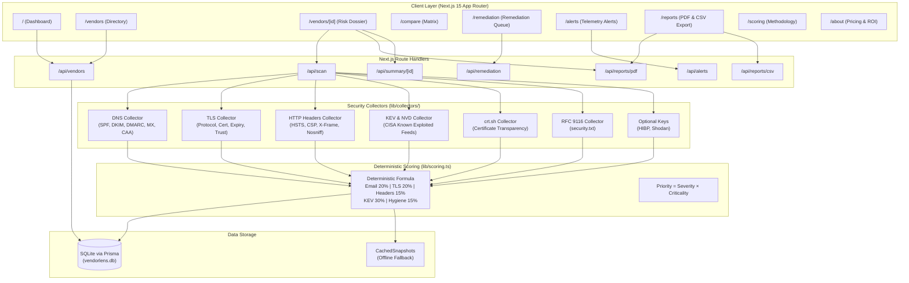

# VendorLens — Third-Party Vendor Risk Intelligence

> Continuous, evidence-backed third-party cybersecurity risk assessment platform with deterministic, transparent scoring.

---

## 📌 Executive Summary & Problem Statement

Modern enterprises depend on hundreds of cloud providers, SaaS vendors, contractors, and supply-chain partners whose security posture evolves continuously. Traditional vendor audits rely on manual 200-question SIG/CAIQ questionnaires that:
1. Take 3–6 weeks of procurement delay.
2. Go stale the moment they are signed.
3. Lack continuous verification of actual perimeter controls.

**VendorLens** continuously gathers public, verifiable security signals about each vendor, translates them into a transparent, deterministic risk score (0–100), and provides security and procurement teams with an evidence-backed, prioritized queue of what to review or fix first.

---

## 🏛️ Architecture Overview



---

## 🚀 Quick Start (One Command Setup)

### Prerequisites
- Node.js 18.18+ or Node.js 20+
- npm 9+

### 1. Installation & First Start
Clone repository and run:
```bash
npm install
npm run dev
```

> **Note on Auto-Seeding:** The `npm run dev` script automatically generates the Prisma Client and executes `prisma/seed.ts`, populating 12 real vendors, 60 days of synthetic score history, active alerts, and offline snapshots.

Open [http://localhost:3000](http://localhost:3000) in your browser.

---

## ⚙️ Environment Variables (`.env`)

VendorLens runs 100% functional **without any paid API keys**. All standard checks (DNS, TLS, Headers, CISA KEV, crt.sh, security.txt) operate keyless.

| Variable | Required | Description |
|---|---|---|
| `DATABASE_URL` | **Yes** | SQLite database connection string (default: `"file:./vendorlens.db"`) |
| `SCAN_RATE_LIMIT` | Optional | Max scan requests per minute per IP address (default: `10`) |
| `ANTHROPIC_API_KEY` | Optional | Enhances executive summaries using Claude 3.5 Sonnet. Defaults to deterministic template if not set. |
| `GEMINI_API_KEY` | Optional | Alternative LLM summary integration using Google Gemini API. |
| `HIBP_API_KEY` | Optional | Enables domain breach lookups via HaveIBeenPwned. |
| `SHODAN_API_KEY` | Optional | Enables open perimeter database listener checks via Shodan. |

---

## 🔬 How Each Collector Works

Every collector enforces strict timeouts, error isolation, and SSRF domain protection:

1. **DNS & Email Security (`lib/collectors/dns.ts`)**
   - Probes TXT records for valid `v=spf1` directives.
   - Evaluates `_dmarc.{domain}` policy (`p=reject` PASS, `p=quarantine` FAIL with warning, `p=none` or missing FAIL).
   - Validates redundant MX records and probes common DKIM selectors (`google`, `default`, `selector1`, `k1`).
   - Verifies Certificate Authority Authorization (CAA) records.

2. **Transport Security / TLS (`lib/collectors/tls.ts`)**
   - Connects to port 443 via Node's native `tls.connect` with timeout protection.
   - Extracts server certificate validity range, subject alt names, and trusted root authority.
   - Validates remaining validity (>30 days threshold).
   - Confirms TLS protocol negotiation (enforces TLSv1.2 or TLSv1.3).

3. **HTTP Web Hardening (`lib/collectors/headers.ts`)**
   - Executes server-side fetch with redirect tracking.
   - Inspects `Strict-Transport-Security` (HSTS), `Content-Security-Policy` (CSP), `X-Frame-Options`, `X-Content-Type-Options: nosniff`, `Referrer-Policy`, and `Permissions-Policy`.

4. **Known Exploited Vulnerabilities (`lib/collectors/kev.ts`)**
   - Pulls CISA's official Known Exploited Vulnerabilities (KEV) catalog JSON.
   - Caches the catalog in memory for 24 hours.
   - Matches vendor primary domain name and declared products against active weaponized zero-days.
   - Queries NIST NVD CVE API 2.0 with rate-limiting backoff.

5. **Certificate Transparency Logs (`lib/collectors/crt.ts`)**
   - Queries `crt.sh` JSON endpoints for public certificate issuances across `%.domain`.
   - Computes unique active subdomains and flags subdomain sprawl (>250 subdomains).
   - Detects expiring auxiliary certificates.

6. **RFC 9116 Security.txt (`lib/collectors/security-txt.ts`)**
   - Probes `https://{domain}/.well-known/security.txt`.
   - Validates required `Contact:` and `Expires:` directives for coordinated vulnerability disclosure.

---

## 🧮 Deterministic Scoring Methodology

The score is deterministic: **Score = 100 − Total Category Deductions** (clamped to 0–100).

### Category Weights:
- **Email & DNS Security**: **20%**
- **Transport Security (TLS)**: **20%**
- **Web Application Hardening**: **15%**
- **Known Exploited Vulnerabilities (CISA KEV)**: **30%**
- **Exposure & Hygiene**: **15%**

### Core Grounding Rule:
- **PASS**: Control verified present and compliant.
- **FAIL**: Control verified absent or insecure (applies fixed deduction).
- **UNKNOWN**: Upstream query timed out or data unavailable. **UNKNOWN never reduces the score**; it lowers the **Coverage %** metric shown alongside the score.

### Priority Queue Formula:
`Priority = Check Severity Weight × Business Criticality Multiplier`
- Criticality Multiplier: High = 3.0, Medium = 2.0, Low = 1.0.

---

## 🛡️ Application Security & SSRF Protection
- **SSRF Blocklist (`lib/ssrf.ts`)**: Resolves domain via IPv4 and IPv6; strictly blocks loopback (`127.0.0.0/8`, `::1`), RFC 1918 private subnets (`10.0.0.0/8`, `172.16.0.0/12`, `192.168.0.0/16`), AWS link-local (`169.254.169.254`), and internal TLDs (`.local`, `.internal`, `.localhost`).
- **Input Sanitization**: Domain inputs are trimmed, lowercased, and stripped of URL protocols.
- **Rate Limiting (`lib/rate-limit.ts`)**: Token bucket limiter on scan endpoints.

---

## 🧪 Testing

Run full test suite via Vitest:
```bash
npm test
```
Includes tests for:
- Deterministic scoring calculations, grade mapping, and risk tier assignments.
- UNKNOWN coverage handling vs deduction isolation.
- Mocked DNS collector evaluations.
- Mocked HTTP security header collector scenarios.

---

## 📄 License
MIT License. Developed for enterprise third-party risk management.
